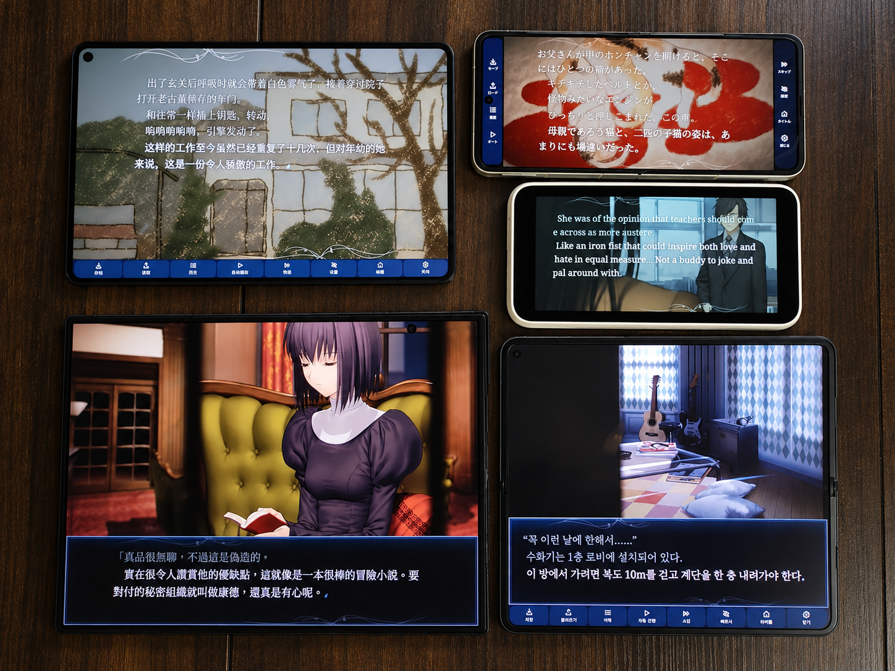

# WITCH ON THE HOLY NIGHT — Unofficial Android Port

English · [한국어](README.ko.md) · [日本語](README.ja.md)

A native Android port designed for phones, tablets and foldables across different screen sizes and aspect ratios. **Install your Steam copy directly on your phone, then play completely offline. No PC is required.**

**[Download the latest APK](https://github.com/david419kr/mahoyo-steam-android-port/releases/latest/download/mahoyo-unofficial.apk)**

## What you need

- A Steam account that owns **WITCH ON THE HOLY NIGHT**.
- A 64-bit ARM Android device running Android 9 or later, with OpenGL ES 3.0.
- Internet access for sign-in and installation, and about **20 GB of free space** for a direct Steam installation. The app shows the required space.

## Install from Steam

1. Install the APK on your Android device. Allow installation from the app you opened it with if Android asks.
2. Open the app and sign in to Steam using **Sign in with QR**, or your account name and password with Steam Guard approval.
3. After ownership verification, choose **Download from Steam**.
4. Wait for downloading and game-data preparation to finish.
5. Tap **Play**.

Once installed, the game works **fully offline**, with no periodic Steam sign-in. If a download is interrupted, sign in again and choose **Download from Steam** to resume.

### Using Steam Mobile on the same phone?

You can display the login QR on another screen:

1. Tap **Show QR on another device** and open the displayed address in a browser on a PC, tablet or another phone.
2. Keep both devices on the same local network: the same Wi-Fi, or a wired connection to the same router.
3. On your phone, tap **Open Steam authenticator**, scan the QR on the other screen and approve the sign-in.

The QR refreshes automatically. The **?** button next to QR sharing explains the steps in the app.

## Controls

| Gesture | Action |
| --- | --- |
| Tap | Advance text |
| Two-finger tap | Show or hide the menu |
| Swipe down | History |
| Swipe up | Settings |
| Swipe right | Save |
| Swipe left | Load |
| Hold for one second | Skip until you release |

Swipe in the opposite direction to close a menu. If dialogue or a menu can scroll, reach the scroll edge before swiping farther. You can reverse a menu-opening swipe to cancel it.

In **Settings → Display**, choose the original 16:9 view or an adaptive layout, fit or fill images, and full-screen or bottom-panel dialogue. **Automatic** dialogue layout adapts to the available screen space. Text size and margins are adjustable.

Saves are kept on this device. Uninstalling the app or clearing its storage removes its installed data and saves.

This is an unofficial project, not affiliated with the game’s publisher or Valve. Game files are downloaded using your own Steam account.
